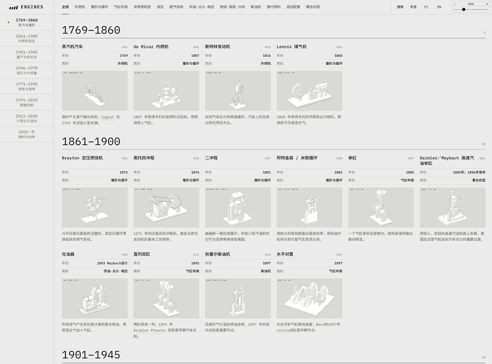

# 发动机图谱 · Engine Atlas



在线访问：**https://engine-atlas.vercel.app**

一个面向中文读者的「汽车发动机全史」静态百科：从 1769 年的蒸汽车到 2026 年 F1 新规则，87 个条目，每个条目配一张可旋转、可播放的等轴测动画示意图。

## 内容

- **87 个条目**：外燃机、内燃机雏形与循环、气缸布局（单缸到 V16、W、星型、H/U）、非常规机型（转子、对置活塞、自由活塞、燃气轮机）、增压、配气机构、供油·点火·电控、燃烧·排放·冷却、柴油机、替代燃料、混动配套、著名机型。不收录纯电驱动。
- **87 张动画示意图**：用 [anatomy](https://skills.wheresryan.sh/anatomy) 技能的等轴测 kit 绘制，统一画风（浅色实体、四档明暗、底座板、左上一行标签）。可拖动旋转、播放/暂停，系统开启"减弱动态"时默认静止。
- **每个条目的详情页**：详细介绍、原理、代表应用、优点与代价、应用现状、来源；难懂术语与车型可悬停查看解释小卡片。
- **中英双语**页面（`zh/`、`en/`），以及术语表、F1 规则年表。

## 交互

- 顶部类型筛选、左侧年代滚动定位、搜索（就地展开为搜索框）。
- 视图缩放：矩形控件，上半为 `− 100% +`，下半为拖杆；支持 Ctrl/⌘ + 滚轮和 `+ - 0` 快捷键。
- 点击条目：示意图放大过渡到详情页（跨文档 View Transitions，需 Chrome 126+ / Safari 18.2+）；返回时回到原滚动位置。

## 运行

纯静态站点，无需构建依赖即可浏览：

```bash
python3 -m http.server 8766
# 打开 http://localhost:8766/zh/index.html
```

请通过 HTTP 访问，`file://` 下转场与部分脚本不可用。

## 重新生成

```bash
python3 atlas.py              # 由 catalog.json 与内容数据生成全部页面
python3 collect_figures.py    # 合并 figures-map*.json，挂载示意图并重建
python3 package_site.py       # 打包可发布的 dist/
node poster.mjs <key>...      # 由示意图导出静态海报 SVG（需要 playwright 与 Chrome）
```

关键文件：

| 路径 | 说明 |
|---|---|
| `atlas.py` | 页面生成器 |
| `catalog.json`、`content.json`、`intro-*.json`、`mentions-*.json`、`terms.json` | 条目、正文、悬停卡与术语数据 |
| `assets/atlas.css`、`assets/atlas.js` | 样式与交互 |
| `assets/figures/` | 每个条目的示意图（自包含 HTML）与海报 SVG |
| `figure-style-spec.md` | 示意图统一规范 |
| `HANDOFF.md` | 项目交接说明与待办 |

## 说明与限制

- 示意图是教学几何模型，不是对特定量产或 F1 发动机的复原；部分尺寸、角度为示意值。
- 正文经过联网查证并附来源，但仍有条目标为"待核实"，未经过人工编辑审阅。
- 悬停卡片中的车型照片来自 Wikimedia Commons 的自由许可素材，以外链方式加载，卡片内显示作者与许可。
- 字体：IBM Plex Mono、Noto Sans SC（SIL OFL），经 Google Fonts 加载。
- 示意图使用的 anatomy kit 为 MIT 许可，见 `assets/figures/LICENSE-anatomy.txt`。
